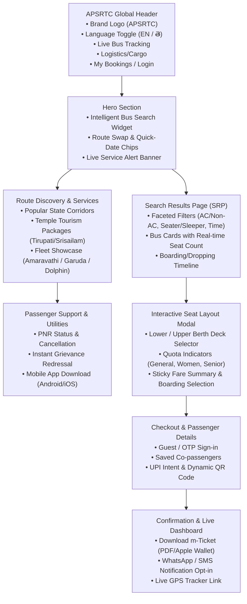

# Product Requirements Document (PRD)
## Project: APSRTC Web Portal Modernization & Experience Redesign
**Document Owner:** Senior UI/UX Engineer & Product Architect  
**Methodology:** Ralph Loop (`snarktank/ralph` / `PageAI-Pro/ralph-loop`)  
**Target Execution Branch:** `ralph/apsrtc-redesign`  
**Current Live Baseline:** [APSRTC Official Portal (apsrtconline.in)](https://www.apsrtconline.in/oprs-web/guest/home.do?h=1)  
**Standard Compliance:** WCAG 2.1 Level AA, Mobile-First Responsive Web Design

---

## 1. Executive Summary & Problem Statement

The Andhra Pradesh State Road Transport Corporation (APSRTC) operates one of the largest public transport networks in India, serving over 10 million passengers daily across intra-state and inter-state corridors (covering Andhra Pradesh, Telangana, Karnataka, Tamil Nadu, and Odisha). 

Despite its extensive physical operations, the current digital booking portal (`apsrtconline.in`) suffers from severe architectural, heuristic, and visual deficiencies:
1. **Desktop-Centric Legacy Layout (2011 XHTML Table Paradigm):** Fixed-width 960px layout, non-responsive viewport, forcing >75% of users accessing via mobile phones to pinch-to-zoom.
2. **Frontend Bloat & Fragile State Management:** A monolithic 280KB uncompressed static JSON array containing 4,000+ stations (`var jsondata = [...]`) is hardcoded directly into the homepage markup, causing severe parse/render latency on 3G/4G rural networks.
3. **Anti-User Navigation Traps:** Core browser functionality is hijacked using `window.history.forward(); noBack()`, preventing back-button navigation and causing user frustration and session drops.
4. **Cognitive Overload & Obsolete Web Artefacts:** Deprecated `<marquee>` tickers, garish red styling, intrusive holiday greeting graphics dominating >50% of the above-the-fold hero space, and trophies displacing core booking actions.
5. **Language & Digital Literacy Barrier:** Despite serving a predominantly Telugu-speaking population, the portal is almost exclusively in English (Telugu is only present as a static logo graphic).
6. **High Drop-off Booking Funnel:** The current 5-step booking flow has cryptic bus types (e.g., "Amaravathi", "Garuda Plus", "Indra", "Super Luxury", "Ultra Deluxe"), confusing seat maps lacking clear sleeper upper/lower deck ergonomics, and high payment failure ambiguity.

### The Redesign Mission
To architect and deliver **"APSRTC Velocity"** — an accessible, lightning-fast, mobile-first web experience that elevates APSRTC from an outdated government portal into a world-class civic transit platform comparable to modern global and domestic benchmarks (RedBus, SBB Swiss Federal Railways, IRCTC NextGen), reducing booking drop-offs by 40% and cutting task completion time in half.

---

## 2. Heuristic Evaluation of the Current System (NN/g 10 Usability Principles)

| NN/g Heuristic | Current Flaw on APSRTC Portal | Redesign Remedy |
| :--- | :--- | :--- |
| **1. Visibility of System Status** | Cryptic spinner dialog without progress indicator; bus seat availability updates only after full page reloads. | Real-time seat locking with 10-minute hold countdown, sticky step progress bar, and instant filter updates. |
| **2. Match Between System & Real World** | Internal jargon (e.g., "Oprs-web", "ATB/OPR Login", "Mofussil services"). | Passenger-centric terminology: "Agent Portal", "Bus Categories with 3D amenity icons", "Boarding Point Landmarks". |
| **3. User Control & Freedom** | Javascript intercepts `window.history.forward()` to prevent back button; no way to edit search without starting over. | Native browser history support, deep-linkable URLs, and persistent editable search header across all funnel stages. |
| **4. Consistency & Standards** | Ancient jQuery UI 1.8 styles mixed with raw XHTML tables and custom FontAwesome 3 hacks. | Unified Design System built with Tailwind CSS, Radix UI primitives, and consistent GovTech design tokens. |
| **5. Error Prevention** | Clicking "Check Availability" with invalid dates throws unstyled JavaScript alerts or refreshes blank inputs. | Inline form validation, intelligent calendar constraints (disabling past dates), and auto-suggest fuzzy search. |
| **6. Recognition Rather than Recall** | Passengers must memorize obscure depot codes and exact boarding stops. | Search autocomplete displays landmark context (e.g., "MGBS, Platform 5", "Benz Circle"), popular searches, and recent routes. |
| **7. Flexibility & Efficiency of Use** | No one-click route swaps; no quick date shortcuts (Today / Tomorrow / Weekend); no guest booking without complex captcha. | One-tap reverse route button, quick-date chips, seamless UPI QR guest checkout, and biometric/OTP login. |
| **8. Aesthetic & Minimalist Design** | Hero occupied by religious/festival banners; award badges push core search off-screen; vertical text marquee causes distraction. | Content-focused hero with high-contrast booking widget, clean card hierarchy, and muted contextual notice badges. |
| **9. Error Recovery** | Payment failures display raw gateway exception codes without refund timelines. | Clear human-readable error cards, automatic retry with alternative UPI/Card gateway, and instant WhatsApp/SMS receipt lookup. |
| **10. Help & Documentation** | Grievance system buried in deep submenu links; 24/7 hotline phone number is unclickable raw text. | Click-to-call support pill in header, WhatsApp chatbot widget, and interactive Live Bus GPS Tracker (`APSRTC LiveTrack`). |

---

## 3. User Personas & Core Journeys

### Persona A: Ravi Teja (Daily Intercity Commuter)
- **Profile:** 28, Software Engineer commuting between Vijayawada (Benz Circle) and Hyderabad (Gachibowli) every weekend.
- **Needs:** Speed, punctuality, Wi-Fi/charging amenities, pick-up point near ORR, fast UPI payment in under 60 seconds.
- **Pain Point:** Frustrated by having to re-enter passenger details every week and inability to track actual bus location on Friday evenings.

### Persona B: Lakshmi (Pilgrim & Family Traveler)
- **Profile:** 54, Homemaker planning a family pilgrimage from Visakhapatnam to Tirupati with elderly parents.
- **Needs:** Telugu language UI, lower-berth sleeper seats for seniors, clear boarding point maps, transparent package details.
- **Pain Point:** Struggles with English-only form labels and cryptic sleeper deck representations on current site.

### Persona C: Venkat (Rural Citizen & Periodic Traveler)
- **Profile:** 42, Farmer traveling from Nandyal to Kurnool on a low-end Android smartphone over 3G/4G connection.
- **Needs:** Ultra-lightweight page load, large touch targets, minimal data consumption, vernacular language clarity.
- **Pain Point:** Current site takes 12+ seconds to load, hangs on autocomplete, and requires desktop zooming.

---

## 4. Information Architecture & Navigation Hierarchy



---

## 5. UI/UX Design System Specification ("APSRTC Velocity")

### 5.1 Design Tokens & Color Palette
- **Primary Red (APSRTC Heritage):** `#B91C1C` (Tailwind `red-700`) — used for brand identity, primary CTA buttons, and active tabs.
- **Primary Dark (Header/Footer):** `#7F1D1D` (Tailwind `red-900`) — provides grounding and authoritative civic presence.
- **Accent Gold (Festival / Royal Class):** `#F59E0B` (Tailwind `amber-500`) — used for promotional badges, ratings, and sleeper highlights.
- **Neutral Dark (Typography):** `#0F172A` (Slate 900) — high-contrast text ensuring WCAG AAA legibility.
- **Neutral Muted:** `#475569` (Slate 600) — secondary descriptions and timestamps.
- **Background Light:** `#F8FAFC` (Slate 50) — clean, non-glare canvas replacing the current stark white/grey table stripes.
- **Card Surface:** `#FFFFFF` with `border: 1px solid #E2E8F0` and `box-shadow: 0 4px 6px -1px rgb(0 0 0 / 0.05)`.
- **Status Green (Seat Available):** `#10B981` (Emerald 500)
- **Status Pink (Ladies Reserved):** `#EC4899` (Pink 500)
- **Status Slate (Booked/Unavailable):** `#CBD5E1` (Slate 300)

### 5.2 Typography & Vernacular Support
- **English Font Family:** `Inter`, `-apple-system`, `BlinkMacSystemFont`, sans-serif.
- **Telugu Font Family:** `Noto Sans Telugu`, `Gautami`, sans-serif.
- **Scale:**
  - H1 Display: `2.25rem` (`36px`), font-weight 700.
  - H2 Section: `1.75rem` (`28px`), font-weight 600.
  - H3 Card Header: `1.25rem` (`20px`), font-weight 600.
  - Body Regular: `1rem` (`16px`), line-height 1.5.
  - Caption/Metadata: `0.875rem` (`14px`), line-height 1.4.

### 5.3 Accessibility (WCAG 2.1 AA) Rules
- **Color Contrast:** All text elements must strictly exceed `4.5:1` against their respective backgrounds.
- **Touch Target Size:** Minimum `48px x 48px` for all interactive elements, seat buttons, date pickers, and tab triggers.
- **Keyboard Navigation:** Explicit visible focus rings (`focus-visible:ring-2 focus-visible:ring-offset-2 focus-visible:ring-red-600`) across all interactive components.
- **Screen Reader Support:** ARIA live regions for dynamic seat selection counts, filter results announcements, and calendar date changes.

---

## 6. Ralph Loop Atomic Task Breakdown (Right-Sized User Stories)

> **Golden Rule of Ralph:** Each user story must be completely implementable and verifiable within a single AI context window (~10-15 minutes of work). Every story contains explicit acceptance criteria, technical requirements, and deterministic verification checkpoints.

```
Execution Sequence:
US-001 -> US-002 -> US-003 -> US-004 -> US-005 -> US-006 -> US-007 -> US-008 -> US-009 -> US-010 -> US-011 -> US-012 -> US-013 -> US-014 -> US-015
```

---

### US-001: Project Scaffolding & Design Token Setup
- **Priority:** 1
- **Description:** As a frontend engineer, I want to initialize the modern Next.js/React project with Tailwind CSS, Lucide icons, and the APSRTC design tokens so that all subsequent components adhere to the design system.
- **Acceptance Criteria:**
  - Project configured with TypeScript, Tailwind CSS, Lucide React, and shadcn-inspired component utilities (`cn` helper).
  - Custom Tailwind color palette defined in `tailwind.config.js` (`apsrtc-red`, `apsrtc-gold`, `apsrtc-slate`, etc.).
  - Fonts configured for Inter and Noto Sans Telugu with CSS variables.
  - Basic layout template with viewport meta tags ensuring mobile responsiveness.
  - Deterministic verification: `npm run build` succeeds without TypeScript or styling errors.

---

### US-002: Accessible Global Header with Language Switcher & Emergency Support
- **Priority:** 2
- **Description:** As a traveler, I want a clean, sticky navigation bar with the APSRTC emblem, customer support hotline, and an instant English/Telugu language toggle so that I can easily navigate and find emergency help.
- **Acceptance Criteria:**
  - Sticky header with responsive navigation bar (`Home`, `Track Bus`, `Ticket Status`, `Logistics/Cargo`, `Helpdesk`).
  - Mobile hamburger navigation drawer for screen widths `< 768px`.
  - Bilingual switcher toggle (`English` <-> `తెలుగు`) persisting selection in state.
  - Click-to-call 24/7 hotline pill (`0866-2570005` / `149`) with telephone URI protocol.
  - Deterministic verification: Component renders cleanly on both desktop (1440px) and mobile (375px) with 0 console warnings.

---

### US-003: High-Performance Station Autocomplete & Mock API Service
- **Priority:** 3
- **Description:** As a commuter, I want a fast, debounce-assisted station search that separates major city hubs from local pickup points without downloading a monolithic 280KB static array on page load.
- **Acceptance Criteria:**
  - Decoupled station search service with indexing for top Andhra Pradesh & inter-state hubs (Vijayawada, Hyderabad, Visakhapatnam, Tirupati, Bengaluru, Chennai, Kurnool, Kakinada, Rajamahendravaram, Ongole, Guntur, Nellore, Kadapa).
  - Autocomplete component with keyboard navigation (Arrow Up/Down, Enter, Esc).
  - Visual separation of "Major Bus Stations" vs "Local Boarding Stops".
  - Empty state and loading skeleton states included.
  - Deterministic verification: Unit test validates search query filtering with <50ms response time.

---

### US-004: Hero Search Booking Widget with Route Swap & Quick-Date Chips
- **Priority:** 4
- **Description:** As a user, I want an elevated, intuitive hero booking card on the homepage where I can select Origin, Destination, Departure Date, and Return Date with quick-action shortcuts.
- **Acceptance Criteria:**
  - Clean card surface overlaying the hero with high contrast text.
  - Origin (`From`) and Destination (`To`) inputs integrated with Station Autocomplete.
  - One-click Route Reverse Swap button with 180-degree smooth SVG rotation animation.
  - Departure Date picker defaulting to current date with minimum constraint set to today.
  - Quick-date chips: "Today", "Tomorrow", "This Weekend" that update the date picker in one tap.
  - "Round Trip" checkbox/switch that toggles the Return Date input with a "Get 10% Off" promotional tag.
  - Deterministic verification: Form validation prevents submission when Origin equals Destination or date is in the past.

---

### US-005: Popular Corridors & Quick-Book Route Cards
- **Priority:** 5
- **Description:** As a frequent commuter, I want to see cards of popular APSRTC routes (e.g. Hyderabad - Vijayawada, Bengaluru - Tirupati) with starting fares and one-click search triggers.
- **Acceptance Criteria:**
  - Grid of top 8 high-traffic corridors displaying Origin -> Destination, distance, duration, starting fare (`₹`), and frequency count.
  - Clicking a route card automatically populates the Hero Search Widget with the chosen route and scrolls smoothly to results.
  - Responsive layout: 4 columns on desktop, 2 columns on tablet, horizontally scrollable carousel on mobile.
  - Deterministic verification: Card click triggers expected search state callback with correct parameters.

---

### US-006: Search Results Page (SRP) Architecture & Faceted Filter Sidebar
- **Priority:** 6
- **Description:** As a passenger, I want a comprehensive search results view with intuitive filter controls so that I can easily find the exact bus service matching my timing and budget.
- **Acceptance Criteria:**
  - Sticky top search summary bar showing Route, Travel Date, Total Buses Found, and an "Modify Search" button.
  - Comprehensive Filter Sidebar (desktop) and Bottom Sheet Modal (mobile) supporting:
    - Bus Class: AC (Amaravathi, Garuda Plus, Indra) vs Non-AC (Super Luxury, Ultra Deluxe, Express).
    - Seating Type: Sleeper, Semi-Sleeper, Seater.
    - Departure Time Slots: Early Morning (00:00 - 06:00), Morning (06:00 - 12:00), Afternoon (12:00 - 18:00), Night (18:00 - 24:00).
    - Boarding & Dropping Point multi-select checkboxes.
  - Reset filters action and live badge count of applied filters.
  - Deterministic verification: Filtering state accurately narrows down the rendered bus list.

---

### US-007: Modern Bus Service Result Card Component
- **Priority:** 7
- **Description:** As a traveler, I want each bus service card to display critical decision factors (departure time, arrival time, duration, available seats, pricing, bus type, and amenities) at a single glance.
- **Acceptance Criteria:**
  - Card displays Service Number, Service Name (e.g., "Amaravathi Multi-Axle Volvo AC"), and Operator badge ("APSRTC").
  - Clear journey timeline showing Departure Time & Point, Travel Duration, and Arrival Time & Point.
  - Live seat availability badge (e.g., "14 Seats Available", color-coded green; or "Only 2 Seats Left" in amber).
  - Base fare with break-up tooltip (Fare + GST + Toll).
  - Amenity icons (Charging Port, Water Bottle, Blankets, Live Tracking, Reading Light).
  - High-visibility "Select Seats" primary button toggling seat map expansion.
  - Deterministic verification: Component passes WCAG contrast checks and renders accurately across breakpoints.

---

### US-008: Interactive Bus Seat Layout & Berth Selector
- **Priority:** 8
- **Description:** As a passenger, I want an interactive, visual seating deck where I can clearly differentiate between lower/upper berths, seater seats, and ladies-reserved quotas with real-time selection.
- **Acceptance Criteria:**
  - Visual bus floorplan rendering steering wheel position to establish orientation.
  - Toggle between "Lower Deck" and "Upper Deck" for sleeper/multi-axle coaches.
  - Explicit visual states:
    - Available (White with subtle border)
    - Selected (APSRTC Crimson Red)
    - Booked / Unavailable (Disabled Slate Grey)
    - Ladies Quota (Soft Pink with female icon, restricted selection rules)
  - Hover / focus tooltip displaying Seat Number, Berth Type, and Fare.
  - Selection limit capped at 6 seats per transaction.
  - Deterministic verification: Selecting and deselecting seats updates the active seats array and total fare in state.

---

### US-009: Boarding & Dropping Point Picker with Integrated Landmark Details
- **Priority:** 9
- **Description:** As a commuter, I want to select my exact boarding and dropping locations with schedule times and landmark descriptions so that I don't miss my bus.
- **Acceptance Criteria:**
  - Step within the seat selection panel to choose Boarding Point and Dropping Point via radio list.
  - Each option includes Pickup Time, Station Name, Landmark (e.g., "Opp. Old Bus Stand, Gate 2"), and Contact point.
  - Selected boarding point highlighted with confirmation badge.
  - Prevents proceeding to passenger details until both boarding and dropping points are selected.
  - Deterministic verification: State transitions to Checkout stage only when valid seats + boarding/dropping points are chosen.

---

### US-010: Streamlined Passenger Details Form with Guest & OTP Flow
- **Priority:** 10
- **Description:** As a user, I want a frictionless passenger information form supporting guest checkout or 1-tap OTP login so that I can complete my booking in under 2 minutes.
- **Acceptance Criteria:**
  - Form dynamically creates input blocks corresponding to each selected seat number.
  - Fields per seat: Passenger Name, Age, Gender (Male, Female, Other), and Senior Citizen concession checkbox.
  - Primary Contact block: Mobile Number (with WhatsApp ticket opt-in checkbox) and Email Address.
  - Option to "Book as Guest" or "Login with OTP" for autofilling saved travelers.
  - Inline validation for phone number (10 digits) and email format with accessible error messages.
  - Deterministic verification: Form prevents checkout when any required passenger field is missing or invalid.

---

### US-011: UPI-First Frictionless Payment Screen
- **Priority:** 11
- **Description:** As an Indian traveler, I want to pay instantly via UPI (PhonePe, Google Pay, Paytm, QR code) or Cards/NetBanking with a 10-minute seat lock countdown timer.
- **Acceptance Criteria:**
  - Sticky fare breakdown card showing Base Fare, GST (5%), Reservation Fee, and Total Payable.
  - Prominent 10:00 minute countdown timer indicating temporary seat lock before timeout.
  - UPI Payment Tab defaulted as primary:
    - Dynamic QR code generation for scanning via mobile UPI apps.
    - UPI VPA ID input (e.g. `username@okhdfcbank`) with "Verify & Pay" action.
    - Fast deep-link buttons on mobile browsers ("Pay with Google Pay", "Pay with PhonePe").
  - Alternative payment accordion for Debit/Credit Cards and NetBanking.
  - Deterministic verification: Mock payment simulation transitions to Confirmation screen or displays informative error card on failure.

---

### US-012: Modern Booking Confirmation & m-Ticket Experience
- **Priority:** 12
- **Description:** As a booked passenger, I want an instant confirmation screen with a downloadable digital m-Ticket, QR code for conductor boarding, and WhatsApp delivery confirmation.
- **Acceptance Criteria:**
  - Clean digital ticket card showing PNR Number, Bus Service, Coach Type, Seat Numbers, Boarding Time & Point, and QR Code.
  - Actions: "Download PDF Ticket", "Print Ticket", "Add to Apple Wallet / Google Wallet", and "Send to WhatsApp".
  - Emergency contact details and bus conductor helpline indicator.
  - "Track Bus" quick link directly opening the tracking interface.
  - Deterministic verification: PDF print stylesheet renders cleanly without extraneous header/footer navigation.

---

### US-013: "APSRTC LiveTrack" GPS Real-Time Bus Tracking Portal
- **Priority:** 13
- **Description:** As a passenger waiting at a bus stand, I want a dedicated tracking page where entering my PNR or Service Number shows the live GPS location, delay status, and ETA of my bus.
- **Acceptance Criteria:**
  - Search input accepting PNR Number or Service Number + Date.
  - Live progress stepper displaying route milestones: Origin Depot -> Passing Checkpoints -> Current GPS Location -> Dropping Point.
  - ETA calculation with status badge (e.g., "On Time", "Delayed by 15 mins").
  - Driver/Conductor contact card with safety masking.
  - Interactive map placeholder (Leaflet/Mapbox compatible) rendering live coordinates.
  - Deterministic verification: Valid mock PNR returns active bus telemetry data; invalid PNR displays helpful recovery instructions.

---

### US-014: Ticket Management Portal (PNR Status, Reschedule & Cancellation)
- **Priority:** 14
- **Description:** As a customer, I want to check my PNR status, view refund policies, and execute ticket cancellations with transparent refund estimates without navigating confusing menus.
- **Acceptance Criteria:**
  - Dedicated "Manage Booking" tab accepting PNR & Mobile Number.
  - Ticket details view displaying booking status (Confirmed, Cancelled, Waitlisted).
  - Cancellation simulator calculating refund deduction based on APSRTC cancellation slab (e.g. >24 hrs: 10% deduction, 12-24 hrs: 25% deduction, <2 hrs: no refund).
  - One-click cancellation confirmation modal with instant refund destination details.
  - Deterministic verification: Cancellation calculation correctly respects time-to-departure business rules.

---

### US-015: Responsive Footer, Accessibility Audit & Backpressure Verification
- **Priority:** 15
- **Description:** As a senior engineer, I want to finalize the site footer, verify full WCAG 2.1 AA accessibility compliance, and run backpressure checks so that the redesign is production-ready.
- **Acceptance Criteria:**
  - Responsive GovTech footer with Official AP State Emblem, Logistics/Cargo link, Citizen Grievance portal, RTGS helpline, Terms & Conditions, and Copyright.
  - Complete elimination of legacy `<marquee>` elements and removal of `window.history.forward()` traps.
  - Lighthouse Accessibility score >= 95 and Performance score >= 90.
  - Automated test suite verifying core booking navigation flow from Home -> SRP -> Seat Selection -> Confirmation.
  - Deterministic verification: `npm test` and `npm run lint` execute with 0 failures.

---

## 7. Verification & Backpressure Framework for the Ralph Loop

During the execution of the Ralph Loop (`ralph.sh`), each iteration must run the following deterministic checks before setting `"passes": true` in `prd.json`:
1. **Type & Syntax Check:** `npm run type-check` (or `tsc --noEmit`) ensures zero TypeScript compilation errors.
2. **Lint & Formatting Check:** `npm run lint` guarantees strict styling compliance.
3. **Unit & Component Testing:** `npm run test` executes component unit tests verifying expected render behavior and state updates.
4. **Accessibility Audit:** Automated check via `@axe-core/react` ensuring zero critical or serious WCAG violations.
5. **Git Commit Hygiene:** The Ralph agent commits each completed story with a structured message: `feat(apsrtc): US-XXX [task title]`.

Once all 15 user stories have `"passes": true`, Ralph will finalize the branch and signal `<promise>COMPLETE</promise>`.
